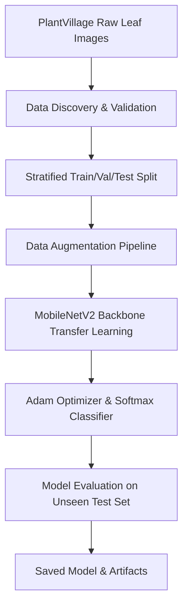
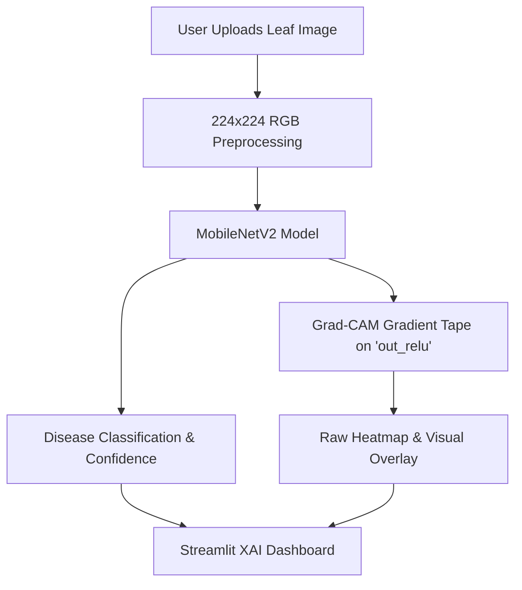

# 🌱 Explainable AI for Crop Disease Detection

> **Academic Milestone 1: College Minor Project**  
> **Topic:** Explainable AI Frameworks for Agriculture and Healthcare  
> **Focus Module:** Crop Disease Classification with Gradient-Weighted Class Activation Mapping (Grad-CAM)

---

## 📌 Abstract & Problem Statement

Plant leaf diseases cause catastrophic reductions in agricultural crop yield worldwide. While deep learning visual classifiers achieve state-of-the-art accuracy on plant pathology benchmarks, standard deep neural networks operate as opaque **"black-box"** decision systems. In agricultural applications, black-box predictions fail to earn user trust among farmers and agricultural extension specialists.

This project delivers an **Explainable AI (XAI)** framework combining **Transfer Learning (MobileNetV2)** and **Grad-CAM**. When a user uploads a crop leaf image, the system not only classifies the plant pathology and confidence level, but also renders visual attribution heatmaps highlighting the exact pixel regions that influenced the model's decision.

---

## 🏗 System Architecture & Workflow

### Training Pipeline


### Inference & Explainability Pipeline


---

## 🔬 Dataset & Preprocessing

- **Dataset**: PlantVillage Public Plant Pathology Image Dataset.
- **Initial Milestone Scope**: 4 representative agricultural classes:
  1. `Tomato Healthy`
  2. `Tomato Early Blight`
  3. `Tomato Late Blight`
  4. `Potato Early Blight`
- **Preprocessing Steps**:
  - RGB conversion and image integrity validation.
  - Image resizing to $224 \times 224 \times 3$.
  - Intensity normalization to $[0.0, 1.0]$.
  - Stratified split: **70% Training**, **15% Validation**, **15% Unseen Test**.
  - Augmentation: Random rotations ($\pm 20^\circ$), horizontal flips, zoom ($\pm 15\%$), and spatial shifts.

---

## 🧠 Model Architecture & Transfer Learning

- **Backbone**: `MobileNetV2` pre-trained on ImageNet.
- **Classification Head**:
  - `GlobalAveragePooling2D`
  - `Dropout(0.2)`
  - `Dense(4, activation='softmax')`
- **Training Strategy**: Two-phase transfer learning:
  - **Phase 1**: Frozen MobileNetV2 backbone; train dense classification head ($lr = 10^{-4}$).
  - **Phase 2**: Unfreeze top backbone layers for fine-tuning ($lr = 10^{-5}$).

---

## 🔍 Explainable AI (Grad-CAM)

Grad-CAM computes the gradient of the target class score $y^c$ with respect to feature activation maps $A^k$ of the final convolutional layer (`out_relu` in MobileNetV2):

$$\alpha_k^c = \frac{1}{Z} \sum_i \sum_j \frac{\partial y^c}{\partial A_{i,j}^k}$$

$$L_{\text{Grad-CAM}}^c = \text{ReLU}\left( \sum_k \alpha_k^c A^k \right)$$

The resulting 2D heatmap is normalized to $[0, 1]$, resized to input image dimensions, and blended with the original leaf image using an OpenCV colormap.

---

## 📂 Project Directory Structure

```
crop-disease-xai/
├── app.py                     # Streamlit XAI Web Dashboard
├── requirements.txt           # Python dependencies
├── README.md                  # Comprehensive documentation
├── .gitignore                 # Git ignore rules
│
├── data/
│   ├── raw/                   # Raw plant leaf images by class
│   ├── processed/             # Cached split metadata
│   └── README.md              # Dataset details
│
├── models/
│   ├── crop_disease_model.keras  # Saved trained model
│   └── class_names.json          # Class labels mapping
│
├── outputs/
│   ├── figures/               # Confusion matrix & training curves
│   ├── reports/               # Test metrics JSON & evaluation summary
│   └── predictions/           # Inference outputs
│
├── src/
│   ├── __init__.py
│   ├── config.py              # Centralized hyperparameters & paths
│   ├── dataset_downloader.py  # Automated PlantVillage downloader
│   ├── data_preprocessing.py # Validation, splits & augmentation
│   ├── model.py               # MobileNetV2 architecture & layer inspector
│   ├── train.py               # Model training & fine-tuning
│   ├── evaluate.py            # Test set metrics & figure generation
│   ├── predict.py             # Inference & Grad-CAM execution
│   ├── gradcam.py             # Genuine Keras GradientTape Grad-CAM
│   └── utils.py               # Qualitative confidence & narrative generator
│
├── tests/
│   └── test_basic.py          # Unit test suite
│
├── docs/
│   ├── VIVA.md                # Viva voce preparation guide
│   ├── MID_EVALUATION.md      # 12-Slide Mid-Evaluation Presentation
│   └── PROJECT_SUMMARY_FOR_CHATGPT.pdf  # Comprehensive PDF report
│
└── examples/
    └── sample_leaves/         # Pre-loaded sample images for UI testing
```

---

## 🛠️ Step-by-Step Execution Commands

### 1. Install Dependencies
```bash
cd crop-disease-xai
pip install -r requirements.txt
```

### 2. Download Dataset
```bash
python src/dataset_downloader.py
```

### 3. Run Unit Tests
```bash
pytest tests/test_basic.py
```

### 4. Train Model
```bash
python src/train.py
```

### 5. Evaluate Model on Test Set
```bash
python src/evaluate.py
```

### 6. Launch Streamlit Web Application
```bash
streamlit run app.py
```

---

## 🎓 Viva & Mid-Evaluation Documentation

- Refer to `docs/VIVA.md` for 21 common viva questions and answers.
- Refer to `docs/MID_EVALUATION.md` for the 12-slide presentation outline.
- Refer to `docs/PROJECT_SUMMARY_FOR_CHATGPT.pdf` for the offline summary document.

---

## 🔮 Future Scope

- **Phase 2**: Healthcare disease risk prediction using tabular ML + SHAP explanations.
- **Phase 3**: Food quality image classification + visual XAI.
- **Phase 4**: Unified Agriculture + Healthcare + Food Quality XAI Platform.
